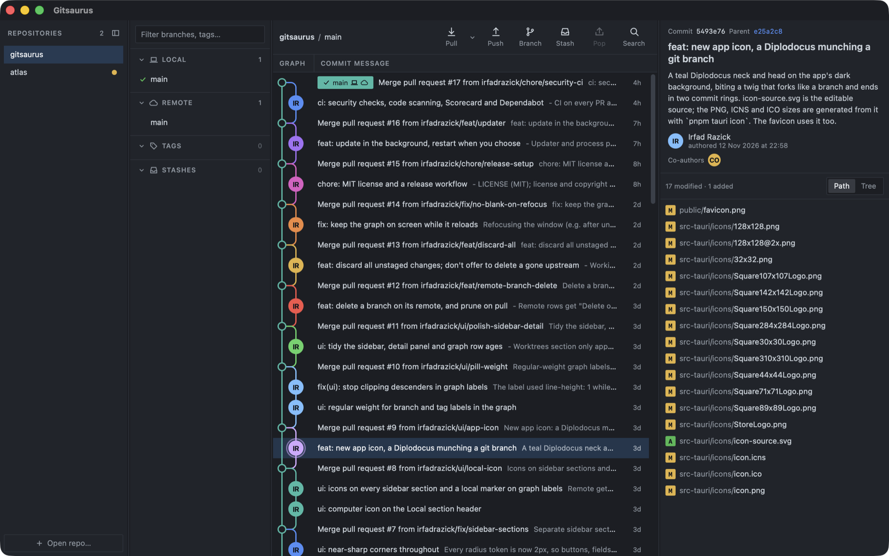

<p align="center">
  
</p>

<h1 align="center">Gitsaurus</h1>

<p align="center">
  A fast, minimal git client for macOS, built on the git you already have.
</p>

<p align="center">
  <a href="https://github.com/irfadrazick/gitsaurus/releases/latest"></a>
  
  <a href="LICENSE"></a>
  <a href="https://github.com/irfadrazick/gitsaurus/actions/workflows/ci.yml"></a>
  <a href="https://github.com/irfadrazick/gitsaurus/actions/workflows/codeql.yml"></a>
  <a href="https://scorecard.dev/viewer/?uri=github.com/irfadrazick/gitsaurus"></a>
</p>

<p align="center">
  <a href="https://github.com/irfadrazick/gitsaurus/releases/latest"><b>Download</b></a> ·
  <a href="#features">Features</a> ·
  <a href="#keyboard-shortcuts">Shortcuts</a> ·
  <a href="#building-from-source">Build from source</a> ·
  <a href="#contributing">Contributing</a>
</p>

<p align="center">
  
</p>

## Why Gitsaurus

- **It's just git.** Every operation runs the `git` command line, so Gitsaurus behaves exactly like git on your machine and uses your existing credentials, config and hooks. Nothing is reimplemented, and nothing is hidden from you.
- **Fast on big repositories.** The commit graph is laid out in Rust and loaded in pages, so it stays smooth on histories with tens of thousands of commits.
- **Stays out of your way.** One window, the everyday actions one click or keystroke away, and confirmation before anything that can lose work.
- **Private.** No accounts, no telemetry, no analytics. See [Privacy](#privacy).

## Features

**History**
- Commit graph with lanes for every branch, and search by message, author or SHA
- Commit details with author, committer, co-authors and changed files
- Unified and split diffs with syntax highlighting, and changed images shown before and after

**Everyday work**
- Stage, unstage and discard files one at a time or all at once, from the mouse or the keyboard
- Commit, or amend the last commit
- Pull (fetch, fast-forward, fast-forward only or rebase), push, branch, stash and pop from the toolbar
- Force push only ever uses `--force-with-lease`, and only after you confirm

**Branches and beyond**
- Branches, remotes, tags, stashes and worktrees in a side column, each with a context menu
- Merge, rebase, cherry-pick, revert and reset, with a conflict resolver
- Worktrees: open one as its own repository, show it in Finder or remove it
- Background fetch on an interval you choose; fetch and pull drop branches deleted on the remote

**Comfort**
- Several repositories open at once, each with a live indicator of uncommitted changes
- Dark theme
- Updates itself in the background and applies the update when you click Restart; it never restarts on its own

## Install

1. Download the latest `.dmg` from [Releases](https://github.com/irfadrazick/gitsaurus/releases/latest). It runs on Apple Silicon and Intel Macs with macOS 13 or later.
2. Open it and drag Gitsaurus into Applications.
3. Gitsaurus isn't notarised by Apple yet, so macOS blocks the first launch. Click Done, then open System Settings > Privacy & Security, scroll to "Gitsaurus was blocked" and click Open Anyway. After that it opens normally.

   Or, from a terminal: `xattr -dr com.apple.quarantine /Applications/Gitsaurus.app`

Gitsaurus needs git. If you don't have it, `xcode-select --install` installs it.

From then on Gitsaurus keeps itself up to date: when a new version has downloaded, a "Restart to update" button appears at the bottom of the Repositories column.

### Verify a download

Each release lists SHA-256 checksums in `SHA256SUMS.txt`, and every file carries a build provenance attestation signed by GitHub Actions. To confirm a download was built by this repository's Release workflow from the tagged source:

```sh
gh attestation verify Gitsaurus_<version>_universal.dmg --repo irfadrazick/gitsaurus
```

## Keyboard shortcuts

| Keys | Action | | Keys | Action |
|---|---|---|---|---|
| <kbd>⌘</kbd> <kbd>⇧</kbd> <kbd>P</kbd> | Pull | | <kbd>⌘</kbd> <kbd>F</kbd> | Search commits |
| <kbd>⌘</kbd> <kbd>P</kbd> | Push | | <kbd>↑</kbd> <kbd>↓</kbd> | Move through commits or changed files |
| <kbd>⌘</kbd> <kbd>⇧</kbd> <kbd>F</kbd> | Fetch | | <kbd>[</kbd> <kbd>]</kbd> | Previous / next change in a diff |
| <kbd>⌘</kbd> <kbd>⇧</kbd> <kbd>N</kbd> | New branch | | <kbd>⇧</kbd> <kbd>F10</kbd> | Open the menu for the focused item |
| <kbd>⌘</kbd> <kbd>⇧</kbd> <kbd>S</kbd> | Stage all | | <kbd>⌘</kbd> <kbd>B</kbd> | Show or hide repositories |
| <kbd>⌘</kbd> <kbd>⇧</kbd> <kbd>U</kbd> | Unstage all | | <kbd>⌘</kbd> <kbd>1</kbd>–<kbd>9</kbd> | Switch repository |
| <kbd>Space</kbd> | Stage or unstage the selected file | | <kbd>⌘</kbd> <kbd>O</kbd> | Open a repository |
| <kbd>⌘</kbd> <kbd>↩</kbd> | Commit | | <kbd>⌘</kbd> <kbd>,</kbd> | Settings |

## Privacy

Gitsaurus has no accounts and sends no telemetry. It only uses the network for:

- your git remotes, when you fetch, pull or push, and for background fetches (set the interval to 0 in Settings to turn them off);
- avatar lookups by email hash, which you can turn off in Settings (<kbd>⌘</kbd> <kbd>,</kbd>);
- a check on GitHub for a new version every few hours, which you can also turn off in Settings.

## Building from source

You need macOS, [Node.js](https://nodejs.org) 22.12 or later, [pnpm](https://pnpm.io), [Rust](https://rustup.rs) and the Xcode command line tools.

```sh
git clone https://github.com/irfadrazick/gitsaurus.git
cd gitsaurus
pnpm install
pnpm tauri dev      # run with hot reload
pnpm tauri build    # build Gitsaurus.app and a .dmg
```

The app is built at `src-tauri/target/release/bundle/macos/Gitsaurus.app`, with the `.dmg` in `src-tauri/target/release/bundle/dmg/`.

### Tests and checks

```sh
pnpm check && pnpm test                     # Svelte/TypeScript types and frontend tests
cd src-tauri
cargo fmt --check
cargo clippy --all-targets -- -D warnings
cargo test                                  # Rust tests against real temporary git repositories
```

A graph timing test against a large repository of your choice is opt-in:

```sh
cd src-tauri
GITSAURUS_PERF_REPO=/path/to/big/repo cargo test --release --test perf -- --ignored --nocapture
```

### How it's built

Gitsaurus is a [Tauri 2](https://tauri.app) app. The Rust backend (`src-tauri/`) runs `git`, parses its output and lays out the commit graph. The frontend (`src/`) is [Svelte 5](https://svelte.dev) and TypeScript, with [Shiki](https://shiki.style) for syntax highlighting.

## Contributing

Bug reports, ideas and pull requests are welcome.

- **Found a bug or have an idea?** [Open an issue](https://github.com/irfadrazick/gitsaurus/issues). For bugs, include your macOS and git versions and the steps to reproduce.
- **Sending a pull request?** For anything larger than a small fix, open an issue first so we can agree on the approach. Keep each PR focused on one change, add tests for new behaviour, and make sure the [checks above](#tests-and-checks) pass. CI runs them on every PR.
- **Found a security problem?** Please report it privately, as described in [SECURITY.md](SECURITY.md), not in a public issue.

## Security

Every pull request runs type checks, tests, `clippy`, `pnpm audit` and [`cargo deny`](src-tauri/deny.toml), which checks for vulnerable dependencies, licences and crate sources. CodeQL scans the TypeScript, Rust and workflow code. `main` only changes through pull requests that pass these checks, every GitHub Action is pinned to a commit SHA, and Dependabot keeps dependencies current. [OpenSSF Scorecard](https://scorecard.dev/viewer/?uri=github.com/irfadrazick/gitsaurus) rates these practices weekly.

Updates are signed, and installed copies only accept an update signed with the project's key.

<details>
<summary><b>Releasing</b> (for maintainers)</summary>

`main` is protected, so the version bump goes through a pull request like any other change:

```sh
git switch -c release/v0.2.0
pnpm set-version 0.2.0
git commit -am "chore: release v0.2.0"
git push -u origin HEAD && gh pr create --fill
gh pr merge --merge --delete-branch   # once CI passes
git switch main && git pull --ff-only
git tag v0.2.0 && git push origin v0.2.0
```

Release tags can't be moved or deleted once pushed, so if a release build fails, fix it and release the next patch version.

The tag starts the Release workflow. It builds a universal `.dmg` and `.zip` and attaches them to a draft release, along with the signed update and the `latest.json` that installed copies check. Check the draft on GitHub, edit the notes and publish it. Installed copies see the update once it's published.

Updates are signed with a key kept in the `TAURI_SIGNING_PRIVATE_KEY` and `TAURI_SIGNING_PRIVATE_KEY_PASSWORD` repository secrets; the matching public key is in `src-tauri/tauri.conf.json`. Keep a backup of the key: without it, installed copies can't be updated.

</details>

## License

Gitsaurus is released under the [MIT License](LICENSE).
